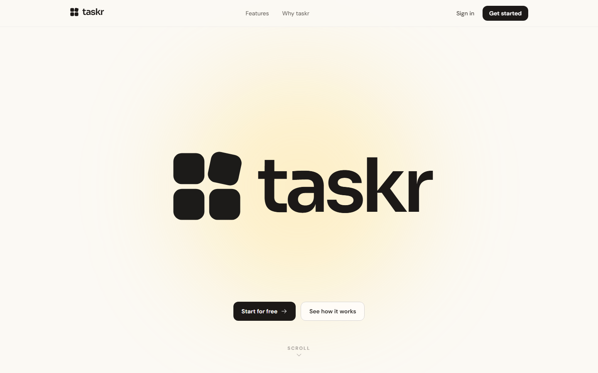
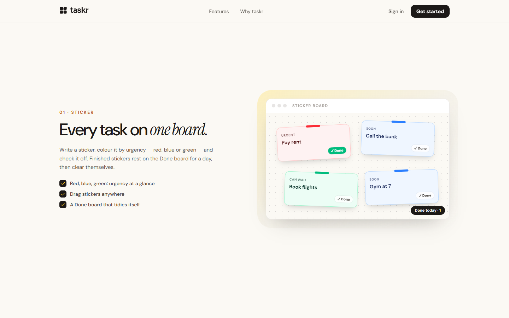
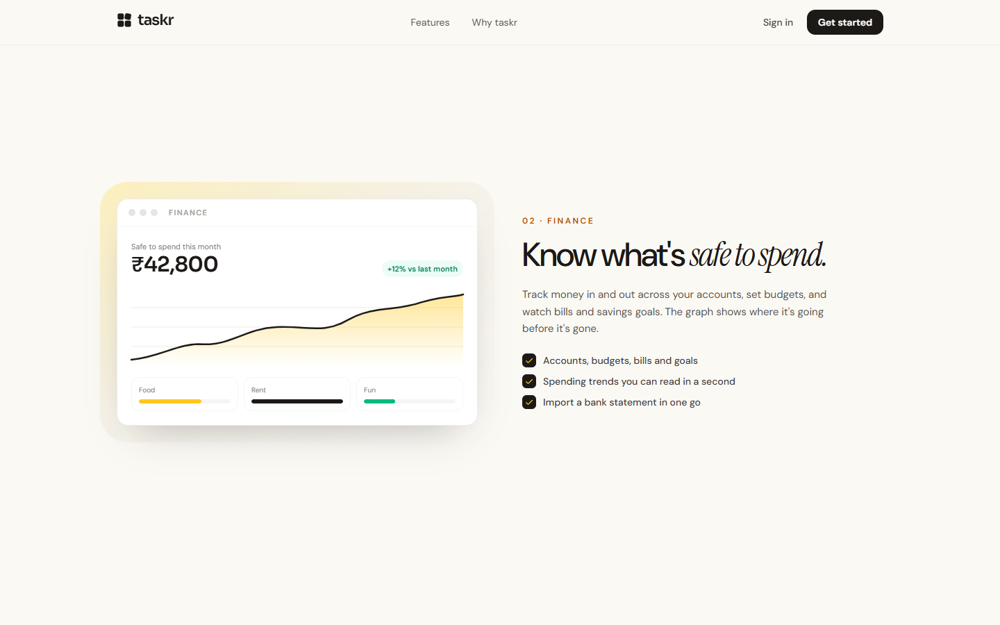
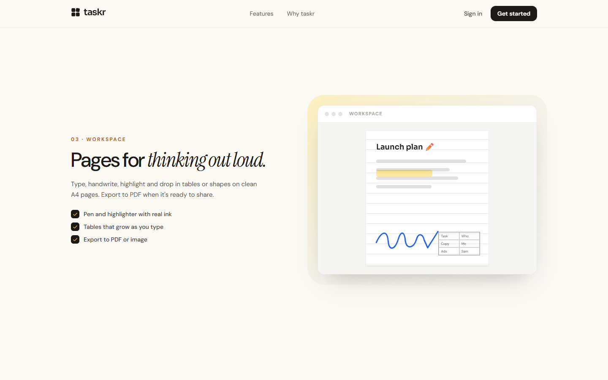
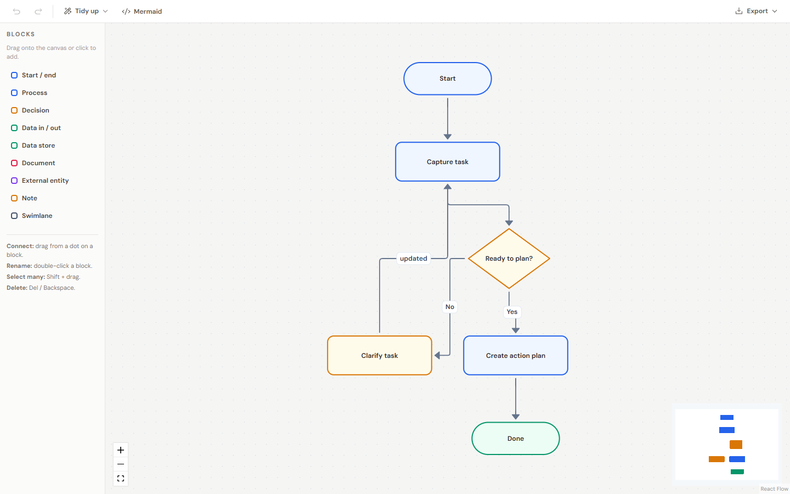
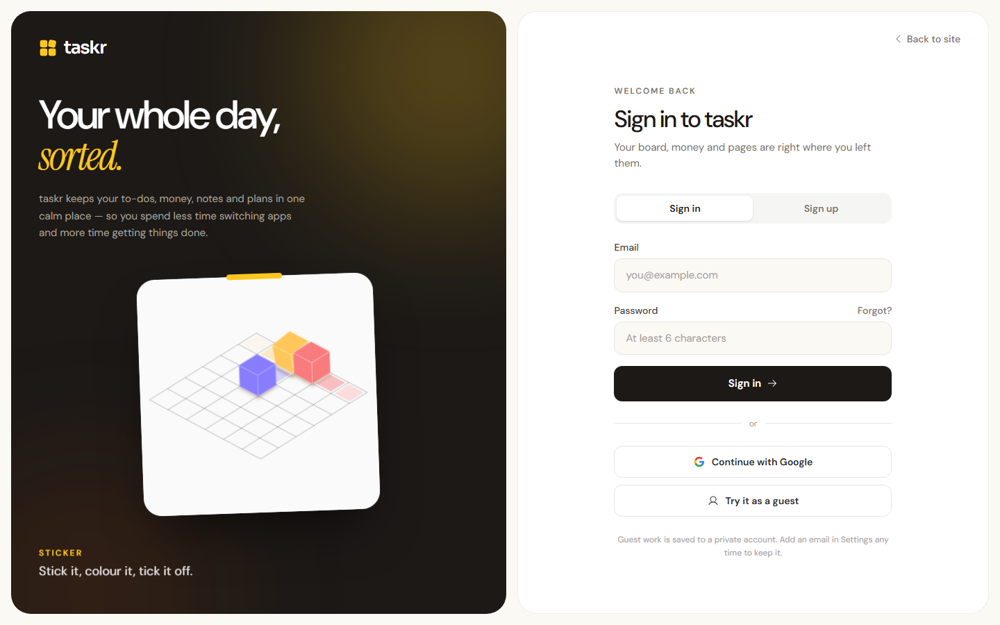
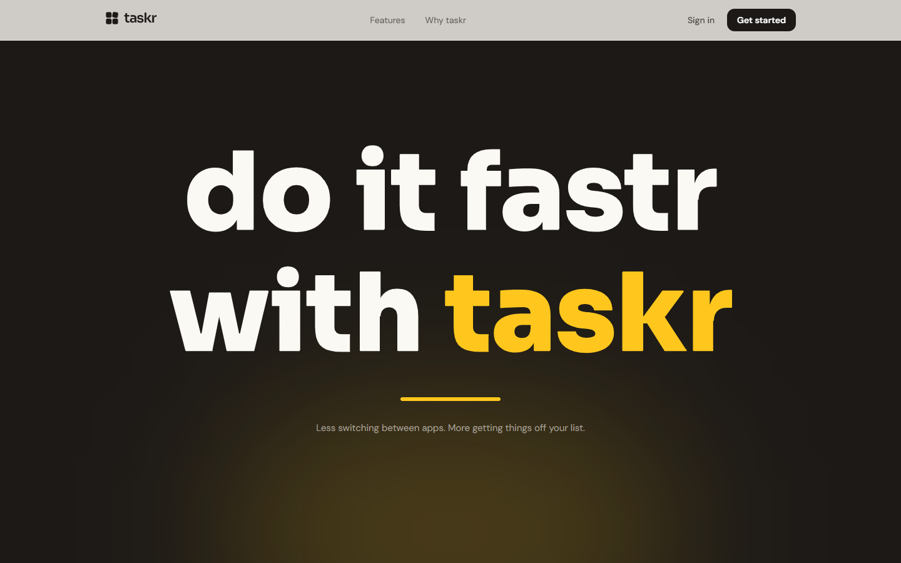

<p align="center">
  <picture>
    <source media="(prefers-color-scheme: dark)" srcset="docs/images/logo-dark.svg">
    
  </picture>
</p>

<p align="center"><strong>do it fastr with taskr</strong></p>

<p align="center">
  Stickers, money, notes and flows in one calm place.<br>
  A to-do board, a personal finance tracker, A4 note pages and a diagram editor — signed in once, saved automatically.
</p>

<p align="center">
  
  
  
  
</p>

<p align="center">
  
</p>

---

## What's inside

taskr is four everyday tools that share one account, one search and one look.

| | Tool | What it's for |
|---|---|---|
| 🟥🟦🟩 | **Sticker** | One board for everything on your mind. Colour a sticker by urgency, drag it anywhere, check it off. |
| 💰 | **Finance** | Accounts, money in and out, budgets, bills, savings goals and investments — and what's safe to spend. |
| 📝 | **Workspace** | A4 pages you can type, handwrite, highlight and fill with tables, shapes, notes and images. |
| 🔀 | **Flow** | A diagram canvas: drag blocks, connect them, tidy the layout, export it. |

Around them sit a **Home** dashboard, a **command palette** (<kbd>Ctrl</kbd>/<kbd>⌘</kbd> + <kbd>K</kbd>), **quick add** (<kbd>Alt</kbd> + <kbd>N</kbd>), **links** between items, a **Help & support** centre and **Settings**.

### Sticker — every task on one board



- **Colour is urgency:** red = urgent, blue = soon, green = can wait.
- Drag stickers anywhere; double-click to edit; **Tidy up** lines them up, most urgent first.
- **Done** moves a sticker to the **Done board** (toggle at the top). Done stickers stay for 24 hours, then clear themselves — or **Put back** if you finished one by mistake.
- Optional due dates; overdue stickers are flagged. Quick add understands `!` for urgent and natural dates (“tomorrow 5pm”).

### Finance — know what's safe to spend



- **Summary:** this month's income, spending and the amount that's safe to spend after bills and goals.
- **Money in & out:** fast entry, search and filters, transfers between accounts, and **CSV import** from a bank statement (duplicates skipped).
- **Budgets** per category, **Bills** that repeat (mark paid / skip), **Savings goals** with the monthly amount needed, **Investments** with value history.
- Nothing is fixed: every account, category, budget, bill, goal and investment can be edited, archived or deleted.

### Workspace — pages for thinking out loud



- A4 pages with lined, grid, dotted or plain backgrounds.
- **Pen and highlighter** (Excalidraw ink), rich **text boxes** (Tiptap), **tables** whose rows grow as you type, **shapes** drawn in their true form, sticky **notes** and **images** (upload, paste or drop).
- Undo/redo, snapping guides, multi-select, alignment, autosave with conflict detection, and **PDF / PNG export**.

### Flow — map it out, then ship it



- Drag blocks (process, decision, data, document, swimlane…) and connect them from their dots.
- **Tidy up** arranges the diagram automatically; templates get you started.
- Import and export **Mermaid**, export **PNG / SVG / PDF**.

### Signing in



Email and password, Google, or **try it as a guest** in one click (add an email later in Settings to keep your work). A short animation confirms every successful sign-in or sign-up before the app slides in.



---

## Tech stack

| Area | Built with |
|---|---|
| App | React 19, React Router 7, Vite 7 |
| Styling | Tailwind CSS 4 · Sora, DM Sans and Instrument Serif fonts |
| Data & auth | Supabase — Postgres with row-level security, Auth (email, Google, anonymous guests), Storage for images |
| Workspace | Excalidraw (ink), Tiptap (rich text), html-to-image (export) |
| Flow | React Flow (`@xyflow/react`), dagre (auto layout) |
| Motion | anime.js (scroll-synced landing animations), Lenis (smooth scrolling), LottieFiles player |
| UI | Phosphor icons, Sonner toasts, cmdk command palette |
| Tests | Vitest |
| Hosting | Firebase Hosting via GitHub Actions |

---

## Getting started

### 1. Prerequisites

- **Node.js 20.19+** (or 22+) and npm
- A **Supabase** project (the free tier is fine)

### 2. Install

```bash
git clone https://github.com/Van5hdeep/Taskr.git
cd Taskr
npm install
```

### 3. Environment variables

Copy the example file and fill in your Supabase project's values (Supabase dashboard → **Project Settings → API**):

```bash
cp .env.example .env
```

| Variable | Used by | Notes |
|---|---|---|
| `VITE_SUPABASE_URL` | Browser app | `https://<project-ref>.supabase.co` |
| `VITE_SUPABASE_PUBLISHABLE_KEY` | Browser app | The **publishable** key (`sb_publishable_…`). Safe to ship to the browser; row-level security protects the data. Older projects can set `VITE_SUPABASE_ANON_KEY` instead. |
| `SUPABASE_SECRET_KEY` | Not used by the app | Kept for admin scripts only. **Never** prefix it with `VITE_` and never commit it. |
| `SUPABASE_JWKS_URL` | Not used by the app | Reference for server-side token checks. |

`.env` is git-ignored; only `.env.example` is committed.

### 4. Set up the database

The schema, row-level security policies and the image storage bucket live in [`supabase/migrations`](supabase/migrations). Apply them with the Supabase CLI (installed as a dev dependency):

```bash
npx supabase login
npx supabase link --project-ref <your-project-ref>
npm run db:push
```

Then, in the Supabase dashboard → **Authentication**:

- **Sign In / Providers → Anonymous sign-ins: on** (needed for “Try it as a guest”).
- **URL Configuration:** add `http://localhost:5173/**` (and your deployed URL) to the redirect URLs.
- *Optional:* enable **Google** and **Confirm email** for production.

### 5. Run it

```bash
npm run dev
```

Open <http://localhost:5173>.

---

## Scripts

| Command | What it does |
|---|---|
| `npm run dev` | Start the dev server |
| `npm run build` | Type-check and build to `dist/` |
| `npm run preview` | Serve the production build locally |
| `npm test` | Run the unit tests once (`npm run test:watch` to keep watching) |
| `npm run db:push` | Apply database migrations to the linked Supabase project |
| `npm run db:types` | Generate `src/lib/database.types.ts` from the linked project |
| `node scripts/build-catchphrase.mjs` | Regenerate the landing page's drawn catchphrase outlines |
| `node scripts/build-readme-logo.mjs` | Regenerate the README logo SVGs |

---

## Keyboard shortcuts

| Keys | Action |
|---|---|
| <kbd>Ctrl</kbd>/<kbd>⌘</kbd> + <kbd>K</kbd> | Search and commands |
| <kbd>Alt</kbd> + <kbd>N</kbd> | Quick add (sticker, expense or income) |
| <kbd>?</kbd> | All shortcuts |
| <kbd>G</kbd> then <kbd>H</kbd> / <kbd>S</kbd> / <kbd>F</kbd> / <kbd>W</kbd> / <kbd>L</kbd> | Go to Home, Sticker, Finance, Workspace, Flow |
| <kbd>V</kbd> <kbd>T</kbd> <kbd>N</kbd> <kbd>R</kbd> · <kbd>P</kbd> <kbd>H</kbd> <kbd>E</kbd> | Workspace: select, text, note, shape · pen, highlighter, eraser |

---

## Project structure

```
src/
├─ app/                 App shell (sidebar), command palette, quick capture, global shortcuts
├─ components/
│  ├─ landing/          Landing page, scroll animations, feature demos, catchphrase outlines
│  ├─ ui/               Shared UI: dialogs, modals, loaders, Lottie player
│  └─ BrandLogo.jsx     The Quad mark and wordmark
├─ features/
│  ├─ auth/             Sign in / sign up / reset, success animation, OAuth callback
│  ├─ home/             Dashboard
│  ├─ sticker/          Sticker board
│  ├─ finance/          Finance tabs, calculations (tested), CSV import
│  ├─ workspace/        Documents list and A4 editor
│  ├─ flow/             Diagrams list and React Flow editor, Mermaid import/export
│  ├─ help/             Help & support centre
│  └─ settings/         User, appearance, account, privacy, about, reset
├─ lib/                 Supabase client, auth, profile, theme, autosave, icon set
└─ index.css            Theme tokens (cream / charcoal / sunflower) and motion
supabase/migrations/    Database schema and row-level security
design/logo/            Logo exploration (the six options and the chosen Quad)
scripts/                Asset generators
docs/images/            README images
```

---

## Your data and privacy

- Every table is protected by **row-level security**: each request can only read and write the signed-in user's own rows.
- Workspace images live in a **private** storage bucket and are shown through short-lived signed links.
- No analytics, ad trackers or AI services. Settings → **Privacy** downloads everything as JSON; Settings → **Reset** deletes it all.

---

## Deployment

The GitHub Actions workflows in [`.github/workflows`](.github/workflows) build the app and deploy it to **Firebase Hosting**: pull requests get a preview channel, and pushes to `main` go live.

Before the first deploy, add these **repository secrets** (GitHub → Settings → Secrets and variables → Actions):

| Secret | Value |
|---|---|
| `VITE_SUPABASE_URL` | Your production Supabase URL |
| `VITE_SUPABASE_PUBLISHABLE_KEY` | Your production publishable key |
| `FIREBASE_SERVICE_ACCOUNT_TASKR_WORKSPACE` | Firebase service account JSON (created by `firebase init hosting:github`) |

Also add the deployed URL to Supabase **Authentication → URL Configuration**.

---

## Credits

- **Logo, colours and UI** — designed for taskr (see [`design/logo`](design/logo)).
- **Animation** — “Rolling Cubes” by Sanjib Paul, from [LottieFiles](https://lottiefiles.com/free-animation/rolling-cubes-WXrwwxymYB) (free animation).
- **Icons** — [Phosphor Icons](https://phosphoricons.com) (MIT).
- **Fonts** — [Sora](https://fonts.google.com/specimen/Sora), [DM Sans](https://fonts.google.com/specimen/DM+Sans) and [Instrument Serif](https://fonts.google.com/specimen/Instrument+Serif) (SIL Open Font License).
- **Libraries** — anime.js, Lenis, React Flow, Excalidraw, Tiptap, Supabase and the rest listed in `package.json`.
